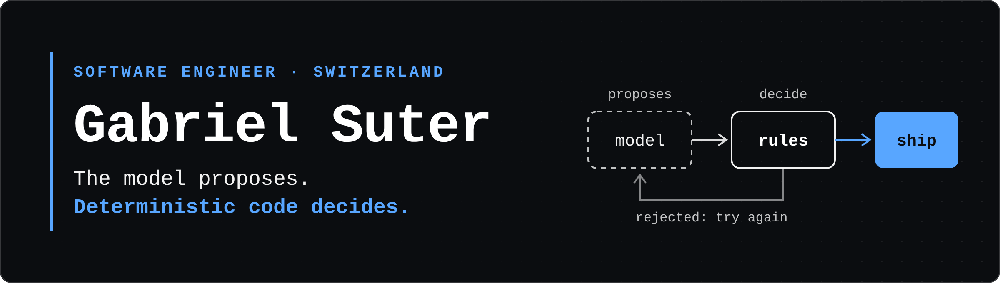

## About

I build products end to end, mostly with coding agents. Agents write most of the
code. I write the specification, the tests and the checks that tell me whether
the result is right.

Completed a four-year software engineering apprenticeship
(Applikationsentwickler EFZ) in Switzerland in 2026.

## Selected work

| Project | What it is | Stack |
|---|---|---|
| **[Entrio](https://app.entrio.cloud)** | SaaS platform with subscriptions, live with Stripe since March 2026. Private repository. | React · TypeScript · Supabase · Stripe |
| **[Aptum](https://github.com/SuterGabriel/Aptum)** | Scheduling and prescription management for therapy practices. The AI layer suggests, the domain decides. | Java · Spring Boot · FastAPI · Angular · Postgres RLS |
| **[ZollPilot](https://github.com/SuterGabriel/ZollPilot)** | Checks customs and shipping documents for completeness and contradictions. | Python · n8n · Angular · Postgres |
| **[Narra](https://github.com/SuterGabriel/Narra)** | Study companion with AI answers whose citations are verified by code. **[Live](https://narra-nine.vercel.app)** | Next.js · Supabase · Claude API |
| **[agent-on-a-leash](https://github.com/SuterGabriel/agent-on-a-leash)** | Guardrails for AI shopping agents. Built at Swiss {ai} Weeks, Viseca challenge. | TypeScript · React |
| **[Stafette](https://github.com/SuterGabriel/stafette)** | Agent that helps patients switch doctors, with a deterministic policy engine. | Python · Next.js |

## How I work

- **Agent instructions live in the repo.** Rules, skills and subagents are versioned next to the code.
- **Checks before trust.** Tests and CI gates decide whether an agent's work is merged.
- **Mistakes are written down.** A development log records where the agent got it wrong.
- **Code decides, not the model.** The model proposes. Deterministic rules check the result before anything is saved or sent.
  
## Stack

<h3 align="center">Daily</h3>
<table align="center">
  <tr>
    <td align="center" valign="middle" width="112" height="104"> <b>TypeScript</b></td>
    <td align="center" valign="middle" width="112" height="104"> <b>Next.js</b></td>
    <td align="center" valign="middle" width="112" height="104"> <b>React</b></td>
    <td align="center" valign="middle" width="112" height="104"> <b>Python</b></td>
  </tr>
</table>

<table align="center">
  <tr>
    <td align="center" valign="middle" width="112" height="104"> <b>PostgreSQL</b></td>
    <td align="center" valign="middle" width="112" height="104"> <b>Supabase</b></td>
    <td align="center" valign="middle" width="112" height="104"> <b>Actions</b></td>
    <td align="center" valign="middle" width="112" height="104"> <b>Claude Code</b></td>
  </tr>
</table>

 

<h3 align="center">Four years at work</h3>
<table align="center">
  <tr>
    <td align="center" valign="middle" width="112" height="104"> <b>C#</b></td>
    <td align="center" valign="middle" width="112" height="104"> <b>.NET</b></td>
    <td align="center" valign="middle" width="112" height="104"> <b>Angular</b></td>
    <td align="center" valign="middle" width="112" height="104"> <b>SQL Server</b></td>
  </tr>
</table>

 

<h3 align="center">Also used</h3>
<table align="center">
  <tr>
    <td align="center" valign="middle" width="112" height="104"> <b>FastAPI</b></td>
    <td align="center" valign="middle" width="112" height="104"> <b>Spring Boot</b></td>
    <td align="center" valign="middle" width="112" height="104"> <b>Docker</b></td>
  </tr>
</table>

<table align="center">
  <tr>
    <td align="center" valign="middle" width="112" height="104"> <b>Stripe</b></td>
    <td align="center" valign="middle" width="112" height="104"> <b>n8n</b></td>
    <td align="center" valign="middle" width="112" height="104"> <b>PostGIS</b></td>
  </tr>
</table>

